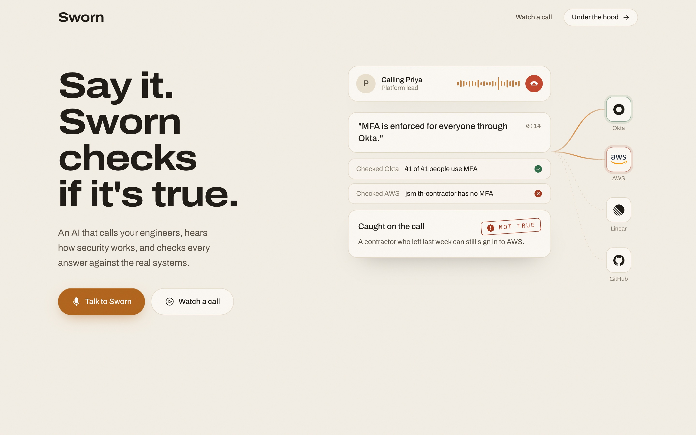
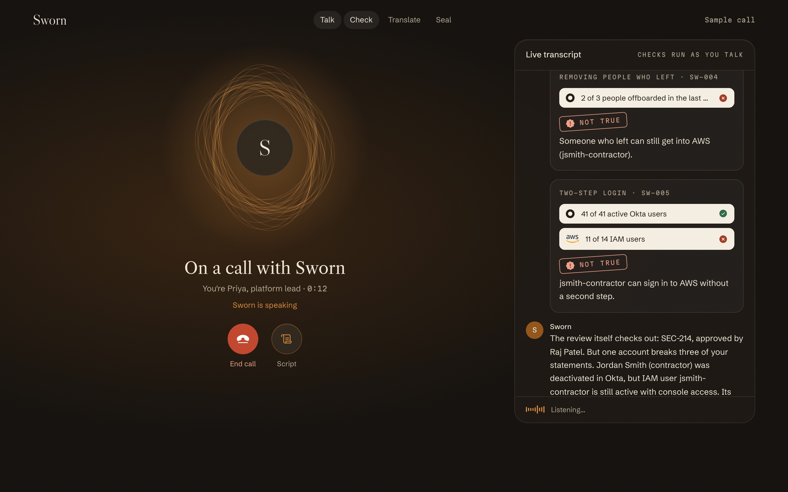
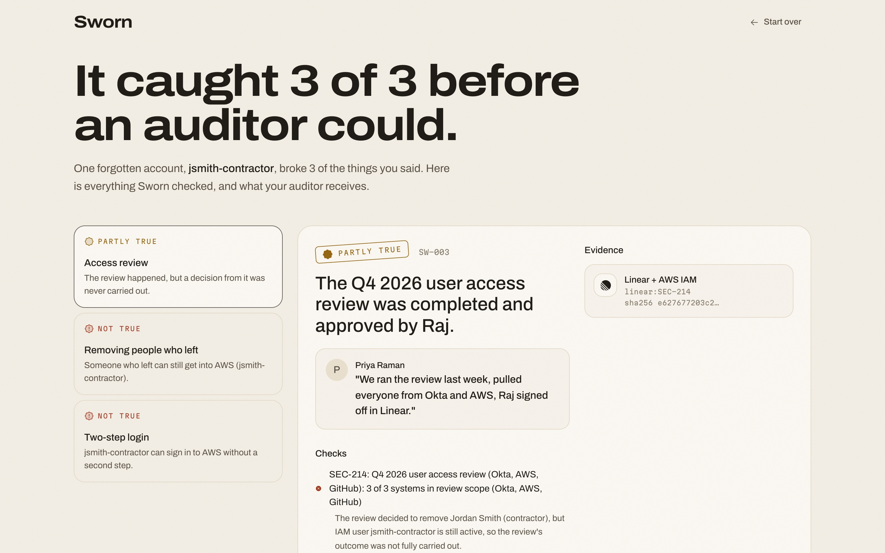
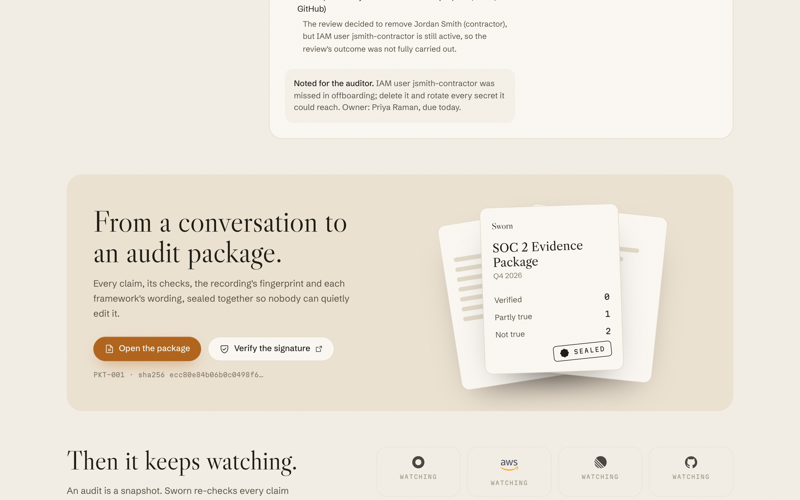
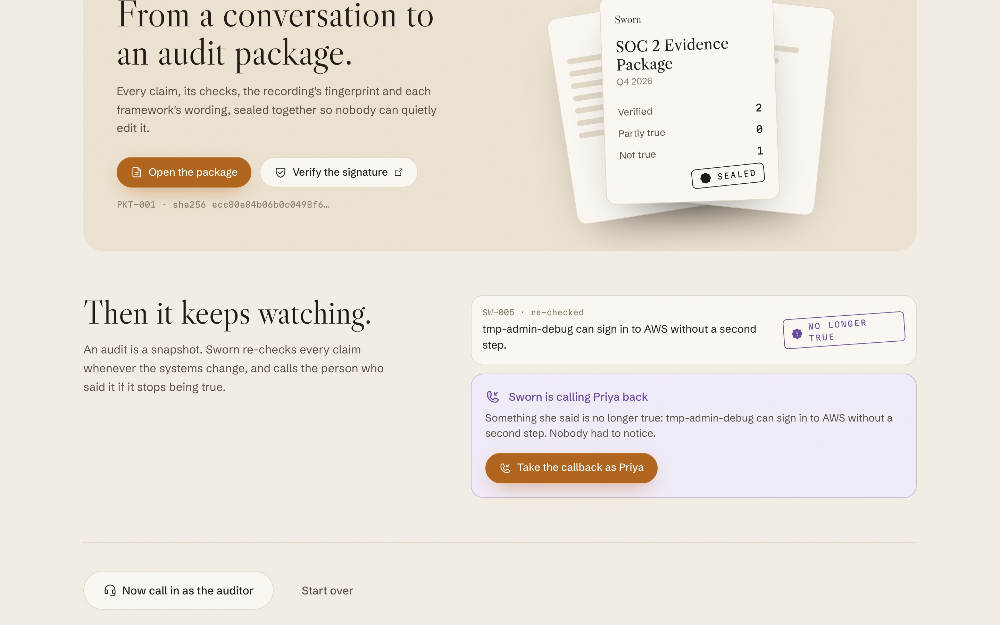

# Sworn

**Say it. Sworn checks if it's true.**

Sworn is a voice agent for security-control reviews. It speaks with control owners, checks their claims against system records, and prepares evidence in language that auditors and buyers can use.

[Try the live demo](https://sworn.loxeai-evt.workers.dev). You can speak with Sworn in the browser or play a sample call.

> **Prototype notice:** Sworn is a buildathon demo, not a production compliance product. It uses fictional company data and seeded system records. Do not submit confidential, personal, customer, or production information, and do not rely on its output as audit evidence without independent review.

## Product screenshots

The screenshots show the fictional Quillfeather demo.



| A control-owner call | Results and checked claims |
| --- | --- |
|  |  |

| Sealed evidence package | Drift detection and callback |
| --- | --- |
|  |  |

## What it does

- **Talk:** A Bolna voice agent interviews a control owner and can answer questions on a separate auditor line.
- **Check:** Statements become typed claims and are compared with the demo's system-of-record data. Disagreements remain visible as exceptions.
- **Translate:** Templates render checked facts for frameworks such as SOC 2, ISO 27001, NIST 800-53, PCI DSS, HIPAA, and FedRAMP 20x.
- **Seal:** A call packet contains canonical JSON, hashes, an Ed25519 signature, and a hash-chained log. The public verification page is at `/verify.html`.
- **Watch:** The demo can re-check claims when its records change and queue a callback when a claim no longer holds.

The auditor endpoint is read-only and answers from verified claims. A signature can show that a record has not changed; it does not prove that the underlying claim is true.

Verification links use a random, packet-specific token. They do not expose the browser session ID or grant access to the rest of that session's ledger. Sharing a packet link gives the recipient access to that packet, including its claim details and any recording link it contains.

## How it works

```text
Browser ───────────────┐
Phone ─────────────────┼── Bolna voice agent ── Cloudflare Worker
                       │                          ├── Ledger Durable Object (SQLite)
Bolna webhooks ─────────┘                          ├── /api/*
                                                  ├── /mcp
                                                  ├── /.well-known/sworn-keys.json
                                                  └── web UI
```

- `src/core/` contains the typed claims, deterministic checks, framework mappings, renderers, ledger engine, signing, auditor answers, and sample-call replay.
- `src/ledger.ts` implements the Cloudflare Durable Object that stores and serializes ledger operations.
- `src/worker.ts` routes the API, Bolna tools and webhooks, browser-call sessions, and static assets.
- `src/mcp.ts` exposes the same ledger through a minimal MCP endpoint.
- `web/` contains the React and Vite application.
- `scripts/setup-bolna.mjs` creates or updates the Bolna agents.

The company and system data in the demo are fictional and seeded. The browser call, checks, drift flow, and packet signing are implemented, but this demo is not connected to production systems.

## Run locally

Requirements: Node.js and npm.

```sh
npm install
npm --prefix web install
npm test
npm run typecheck
npm run build
npm run dev:web
```

`npm run dev:web` starts the UI on port 5180 and proxies API requests to the configured Worker. `npm run dev` starts the local Worker on port 8787.

For local Worker secrets, use a `.dev.vars` file in the repository root. Do not commit secret values:

```dotenv
BOLNA_API_KEY=...
SIGNING_KEY_JWK=...
TOOL_TOKEN=...
WEBHOOK_TOKEN=...
DEMO_PASSCODE=...
```

## Deploy

Set the required secrets in your Cloudflare environment, then deploy the Worker and configure the Bolna agents:

```sh
npx wrangler secret put BOLNA_API_KEY
npx wrangler secret put SIGNING_KEY_JWK
npx wrangler secret put TOOL_TOKEN
npx wrangler secret put WEBHOOK_TOKEN
npx wrangler secret put DEMO_PASSCODE
npm run setup:bolna -- https://<your-worker>.workers.dev
npm run deploy
```

Keep the Ed25519 private signing key and all service tokens out of source control. Configure separate credentials for development and production, and rotate any credential that is exposed.

## Security and privacy

This repository is a demo and has not been presented as production-ready or independently certified. Before using it with real people or systems:

- Review access controls, authentication, rate limits, and abuse protections for every public endpoint.
- Confirm Bolna and Cloudflare data handling, recording and transcript retention, access, and deletion settings.
- Provide required AI and recording notices and obtain consent before recording calls.
- Use synthetic data for testing. Do not put production credentials, customer records, or personal data in demo calls.
- Review generated packets and framework mappings with qualified security and compliance staff before using them.

The demo's recording notices and signatures do not replace legal review, a privacy program, or a security assessment.

## Development

```sh
npm test                 # Core checks, drift, rendering, replay, and signing
npm run typecheck        # TypeScript checks for the Worker
npm run build            # Build the web UI
npm --prefix web run lint
```

## Team

- Arjav Mehta, founder and CEO, LoxeAI
- Karthik, co-founder and CTO, LoxeAI

Built by LoxeAI for the Bolna Symphony Buildathon. Voice calls run on [Bolna](https://bolna.ai).
